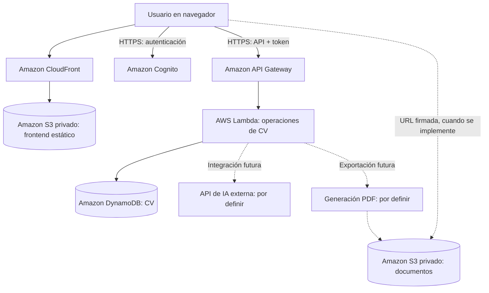

# IACV-ARC-002 — Arquitectura técnica de infraestructura AWS

| Campo | Valor |
|---|---|
| Proyecto | iArmatuCV |
| Código | IACV-ARC-002 |
| Versión | 1.0 |
| Fecha | 2026-10-23 |
| Estado | Propuesta de arquitectura — pendiente de despliegue y validación |
| Documento relacionado | IACV-ARC-001 — Arquitectura de Software e Infraestructura Cloud |
| Destinatarios | Equipo del proyecto, docente, Codex y responsables de infraestructura |

## 1. Propósito

Definir la **arquitectura de infraestructura AWS** propuesta para iArmatuCV, sus servicios, límites, flujos, seguridad, despliegue, observabilidad y decisiones abiertas. Este documento sirve como contrato de arquitectura para planificar y revisar infraestructura; **no autoriza a crear recursos, realizar despliegues ni generar cargos sin aprobación**.

## 2. Alcance y exclusiones

**Incluye:** topología cloud, responsabilidades de servicios AWS, flujo de solicitudes, almacenamiento, autenticación y autorización a nivel de infraestructura, conectividad con servicios externos, principios de seguridad, entornos, observabilidad, costos, recuperación y criterios de aceptación de infraestructura.

**Excluye expresamente:** implementación Angular, componentes UI/CSS, estructura de código frontend, lógica de negocio del backend, código de funciones Lambda, contratos detallados de API, prompts del asistente, elección del proveedor de IA, biblioteca o método para generar PDF y plantillas de CV. Esos asuntos tendrán documentación independiente.

## 3. Estado de decisiones

| Elemento | Estado | Decisión / nota |
|---|---|---|
| Arquitectura serverless | Definido conceptualmente | No se administrará EC2 para la solución inicial |
| Hosting frontend | Propuesto | S3 privado + CloudFront |
| Frontend | Definido fuera de este documento | Angular; aquí solo importa su distribución como archivos estáticos |
| Entrada de API | Propuesto | Amazon API Gateway (HTTP API, sujeto a validación de requisitos) |
| Ejecución de operaciones ABM | Propuesto | AWS Lambda; funciones separadas por operación, siguiendo referencia docente |
| Persistencia | Propuesto | Amazon DynamoDB |
| Autenticación | Propuesto | Amazon Cognito User Pool |
| Archivos exportados | Propuesto | Bucket S3 privado independiente del hosting |
| IA | Pendiente | Proveedor/API externa y alcance funcional aún sin definir; Bedrock no disponible en el entorno académico |
| PDF | Pendiente | Tecnología de generación y mecanismo de ejecución aún sin definir; se reserva integración con almacenamiento privado |
| Región AWS | Pendiente | Seleccionar según cuenta, políticas, latencia y disponibilidad |
| Entornos | Propuesto | Desarrollo y producción separados lógicamente; definir cuentas o stacks |
| Infraestructura como código | Pendiente | Evaluar CloudFormation, CDK o Terraform según restricciones académicas |
| Dominio propio | Pendiente | Puede iniciarse con dominio CloudFront |

**Convención:** «propuesto» no significa implementado. No asumir recursos existentes ni credenciales configuradas.

## 4. Vista de contexto

El diagrama expresa **dependencias lógicas**, no conectividad directa de CloudFront a API Gateway ni un acceso público a los buckets. Cognito y API Gateway son destinos distintos consumidos por el navegador.

## 5. Componentes y responsabilidades

| Servicio | Responsabilidad de infraestructura | Consideraciones |
|---|---|---|
| Amazon S3 (web) | Almacenar artefactos estáticos compilados | Bucket privado; acceso desde CloudFront mediante Origin Access Control (OAC); bloquear acceso público |
| Amazon CloudFront | Distribución HTTPS y caché de la web | Certificado administrado, políticas de caché; manejo de rutas SPA sin exponer errores de API |
| Amazon Cognito | Gestión de identidad de usuarios | User Pool; configuración de cliente público sin secreto embebido; MFA y recuperación según requisitos |
| Amazon API Gateway | Exposición HTTPS de rutas | Autorizador JWT para rutas privadas, CORS restringido a orígenes permitidos, throttling |
| AWS Lambda | Cómputo bajo demanda para ABM e integraciones | Permisos IAM mínimos por función; límites de tiempo, memoria y concurrencia |
| Amazon DynamoDB | Persistencia de datos de CV | Diseño de claves por propietario, cifrado, recuperación puntual si se habilita, políticas de retención |
| Amazon S3 (documentos) | Almacenar exportaciones futuras | Bucket privado distinto del hosting; URLs firmadas de duración limitada; ciclo de vida |
| AWS Secrets Manager / SSM | Guardar secretos de integraciones | Nunca incluir claves de IA en el navegador ni en el repositorio; definir servicio según necesidad/costo |
| Amazon CloudWatch | Logs, métricas y alertas | Retención configurada; no registrar CV completos ni datos sensibles innecesarios |
| AWS Budgets | Presupuestos y alertas de gasto | Configurar antes de pruebas públicas; presupuestos no bloquean automáticamente consumos |

## 6. Flujo de publicación de la web

1. El proceso de build (definido por el equipo frontend) produce archivos estáticos.
2. Se publican en el bucket privado de hosting.
3. CloudFront entrega el contenido al navegador por HTTPS usando OAC para leer S3.
4. Para navegación SPA se configura el fallback correspondiente a `index.html` **solo para rutas de la aplicación**, sin ocultar errores de recursos faltantes ni de API.
5. Se define una política de caché: archivos con hash y larga duración; `index.html` con actualización rápida.

No se utilizará el endpoint de *S3 static website hosting* como origen público si se adopta S3 privado + CloudFront OAC.

## 7. Flujo de identidad y acceso

1. El usuario inicia sesión mediante Cognito.
2. El navegador obtiene un token adecuado para invocar la API.
3. API Gateway valida el JWT en rutas protegidas.
4. La función Lambda toma la identidad verificada del contexto de autorización; **no confía en un `usuarioId` enviado libremente por el cliente**.
5. Las operaciones en DynamoDB se limitan a los registros de ese usuario.
6. IAM limita qué recursos puede consultar o modificar cada función.

**Nota:** autenticación (quién es el usuario) y autorización (qué CV puede modificar) son controles distintos; el JWT por sí solo no sustituye la verificación de pertenencia del registro.

## 8. Flujo de ABM y rutas conceptuales

| Operación | Método y ruta propuesta | Función Lambda | Acceso a datos esperado |
|---|---|---|---|
| Crear | `POST /cv` | `crearCV` | PutItem |
| Listar propios | `GET /cv` | `listarCV` | Query por usuario |
| Obtener propio | `GET /cv/{id}` | `obtenerCV` | GetItem con clave compuesta |
| Modificar propio | `PUT /cv/{id}` | `actualizarCV` | UpdateItem condicionado |
| Borrar propio | `DELETE /cv/{id}` | `borrarCV` | DeleteItem condicionado |

La definición exacta de solicitudes, respuestas, errores, validaciones y semántica PUT/PATCH se realizará en documentación de API, **no en este documento**. Las cinco funciones separadas siguen el patrón de ABM expuesto por el docente; su granularidad puede revisarse mediante decisión de arquitectura documentada.

### Consideración de modelo de datos

Se propone una clave de partición `usuarioId` y clave de ordenamiento `cvId` para permitir consultas por propietario sin escanear toda la tabla. El diseño definitivo de entidades, atributos e índices queda reservado para el documento de datos.

## 9. Integraciones pendientes

### 9.1 Asistente de IA

Se prevé un punto de integración protegido a través de API Gateway y Lambda. **No se seleccionó proveedor ni modelo**; no deben codificarse nombres, SDK, endpoints o claves como decisiones definitivas. Evaluar costos, cuotas, latencia, protección de datos y política de retención antes de habilitarlo.

### 9.2 Generación y descarga de PDF

Se prevé que una operación autorizada genere o solicite un documento y lo almacene en S3 privado. **No se definió el motor de generación** ni si el procesamiento será síncrono o asíncrono. Como alternativa de entrega, considerar URL prefirmada con vencimiento breve, validando propiedad del CV y del archivo.

## 10. Seguridad mínima

- HTTPS extremo a extremo para accesos públicos.
- Buckets privados, S3 Block Public Access y CloudFront OAC para hosting.
- IAM con privilegio mínimo y roles separados por función cuando sea viable.
- API Gateway con autorización JWT para endpoints privados.
- CORS explícito para dominios de frontend; CORS no reemplaza autenticación.
- Datos cifrados en reposo mediante capacidades administradas de AWS.
- Secretos en servicio administrado, no en código fuente ni variables públicas del frontend.
- Sanitización de logs; no registrar datos completos del CV, tokens o secretos.
- Protección contra abuso: límites de tasa y concurrencia, especialmente para futura IA.
- Política de eliminación, retención y respaldo por definir antes de producción.

## 11. Entornos y despliegue

**Propuesta:** al menos `dev` y `prod`, con nombres, configuraciones y permisos diferenciados. Los recursos deben etiquetarse con `Project=iArmatuCV`, `Environment`, `Owner` y `ManagedBy` cuando corresponda.

La infraestructura se implementará preferentemente mediante infraestructura como código una vez elegida la herramienta. Evitar cambios manuales no documentados. Los pasos operativos, comandos y pipelines pertenecen al futuro runbook de despliegue.

## 12. Observabilidad y costos

- CloudWatch: errores y duración de Lambda; 4xx/5xx y latencia de API Gateway; métricas de DynamoDB; alarmas relevantes.
- Definir períodos de retención de logs y evitar información personal en registros.
- AWS Budgets: alerta de costo total y revisión periódica de servicios activos.
- Configurar límites razonables de concurrencia y consumo para integraciones externas.
- Verificar cuotas, precios y capa gratuita vigentes en la cuenta antes de implementar; **no asumir costo cero**.

## 13. Disponibilidad y recuperación

Los servicios administrados reducen tareas operativas, pero no eliminan fallas. Antes de producción definir objetivos de disponibilidad, retención, backups de DynamoDB, versionado o retención de archivos S3, recuperación ante borrados y procedimientos de restauración. No se establecen RTO/RPO sin requisitos acordados.

## 14. Riesgos y dependencias

| Riesgo | Mitigación propuesta |
|---|---|
| Costos inesperados | Presupuestos, alarmas, cuotas y revisión de recursos |
| Acceso cruzado a CV de otros usuarios | Identidad verificada y claves por propietario; pruebas de autorización |
| Exposición de datos en S3 | Buckets privados, políticas restringidas y enlaces temporales |
| Pérdida de información | Estrategia de backup y recuperación pendiente |
| Dependencia de IA externa | Proveedor desacoplado, límites y alternativa de degradación |
| Complejidad de PDF | Validar requisitos y método antes de escoger infraestructura |
| Restricciones de cuenta educativa | Inventario previo de permisos y servicios habilitados |

## 15. Criterios de aceptación de la arquitectura (a validar)

- [ ] Sitio servido por HTTPS desde CloudFront, con bucket de origen privado.
- [ ] API publicada por HTTPS con rutas y autorizador configurados.
- [ ] Cinco operaciones ABM ejecutables mediante Lambda.
- [ ] DynamoDB permite listar CV por usuario sin `Scan` global.
- [ ] Pruebas demuestran que un usuario no puede consultar/modificar CV ajenos.
- [ ] Logs y métricas disponibles sin datos sensibles innecesarios.
- [ ] Alertas presupuestarias activadas.
- [ ] Arquitectura desplegada coincide con diagrama y registro de decisiones.
- [ ] Integraciones IA/PDF permanecen desacopladas hasta decisión formal.

## 16. Registro de decisiones de arquitectura (ADR)

| ID | Decisión | Estado |
|---|---|---|
| ADR-001 | Preferir arquitectura serverless | Propuesta aceptada conceptualmente |
| ADR-002 | Hosting estático mediante S3 privado + CloudFront | Propuesta |
| ADR-003 | ABM mediante API Gateway + cinco Lambda + DynamoDB | Propuesta alineada con clase |
| ADR-004 | Cognito para identidad y JWT para API | Propuesta |
| ADR-005 | IA externa desacoplada, proveedor pendiente | Abierta |
| ADR-006 | PDF privado en S3, mecanismo pendiente | Abierta |
| ADR-007 | Herramienta IaC y región AWS | Abierta |

Toda modificación sustancial debe generar una nueva versión del documento o un ADR específico.

## 17. Próximos documentos (sin duplicar responsabilidades)

- `IACV-ARC-003_Decisiones_Arquitectura_ADR.md`: decisiones y alternativas.
- `IACV-OPS-001_Plan_Despliegue_AWS.md`: secuencia de provisión y validación.
- `IACV-SEC-001_Seguridad_Cloud.md`: matriz de permisos, datos y controles.
- `IACV-API-001_Contrato_API.md`: endpoints y formatos, a cargo de la mesa backend.
- `IACV-DAT-001_Modelo_Datos.md`: claves, atributos e índices, a cargo de datos/backend.

## 18. Indicaciones para Codex

1. Tratar este documento como **especificación de arquitectura propuesta**, no como inventario de recursos existentes.
2. No crear, modificar ni borrar recursos AWS sin confirmación explícita.
3. No elegir proveedor de IA, motor PDF, región, dominio ni herramienta IaC sin una decisión registrada.
4. Mantener fuera de esta carpeta la implementación de frontend y backend.
5. Ante ambigüedad, proponer un ADR con alternativas, impacto y decisión pendiente.
6. Priorizar seguridad, mínimo privilegio, costos controlados y despliegues reproducibles.
7. Al generar documentación adicional, conservar códigos, versiones, estado y referencias cruzadas.

---

**Control de cambios:** v1.0 — Creación del documento técnico de arquitectura AWS; IA y PDF permanecen sin definir.
